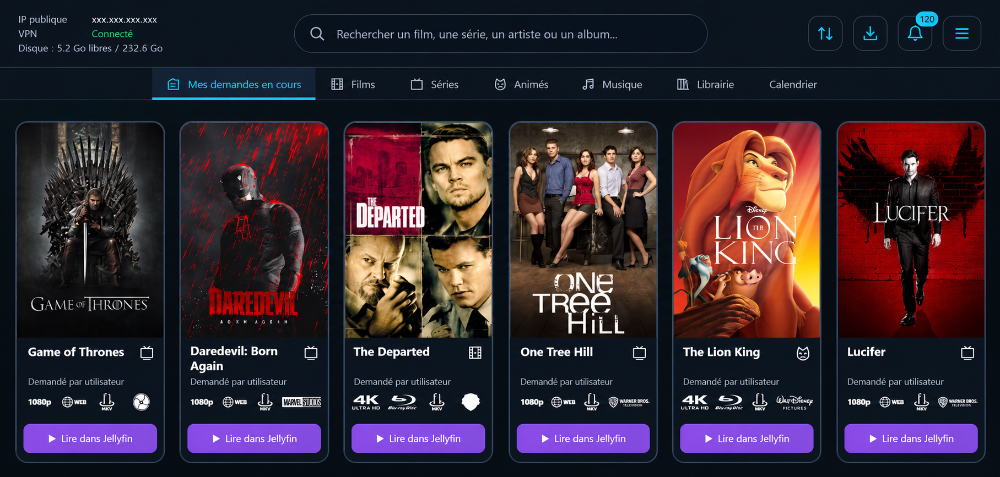
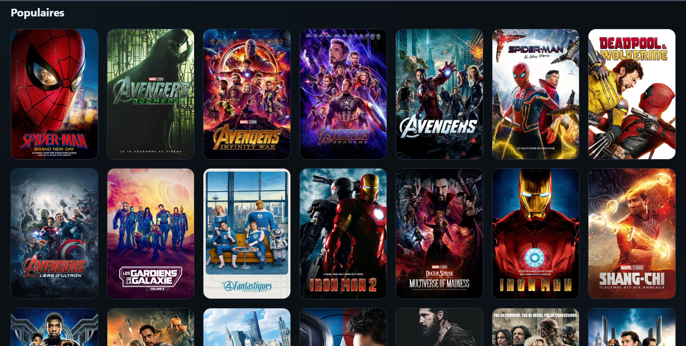
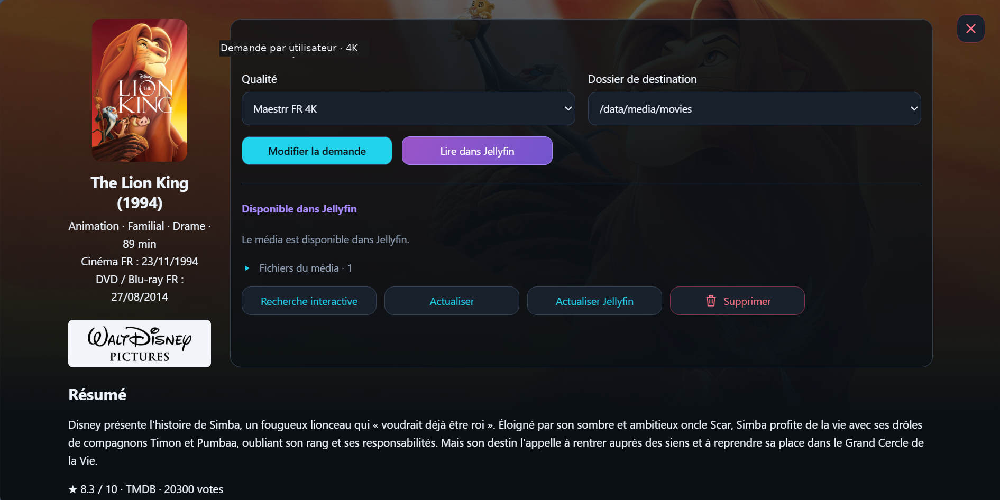
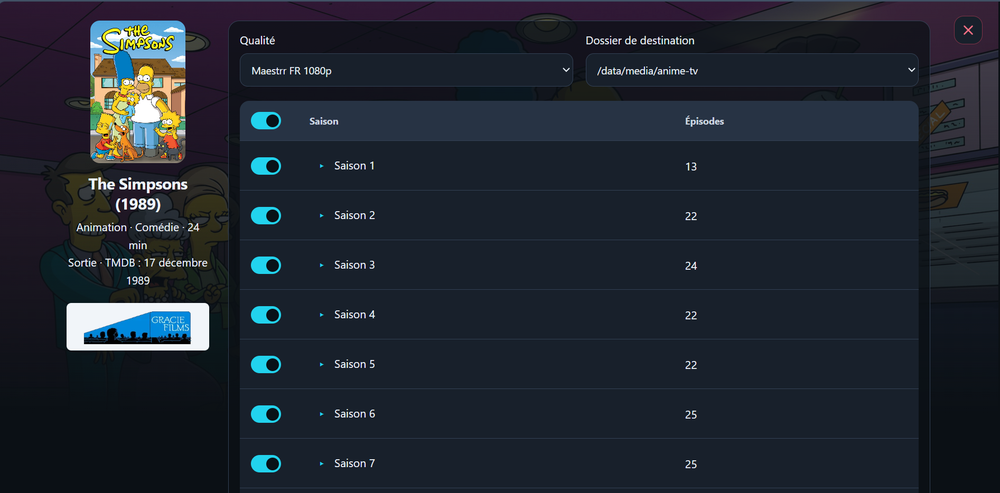
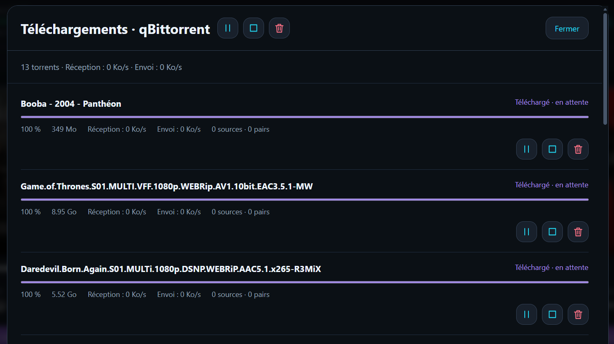
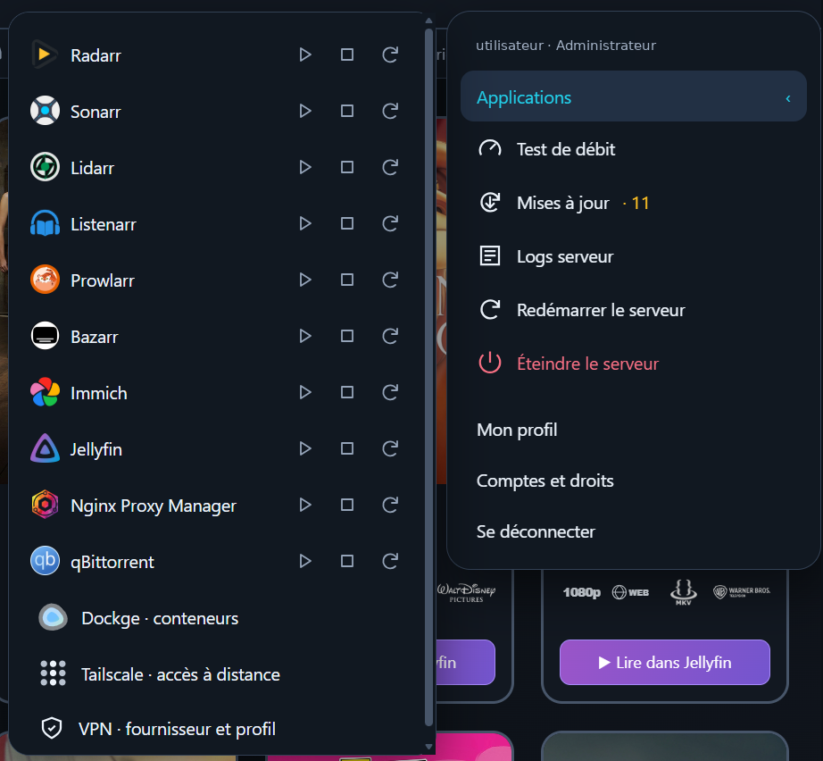
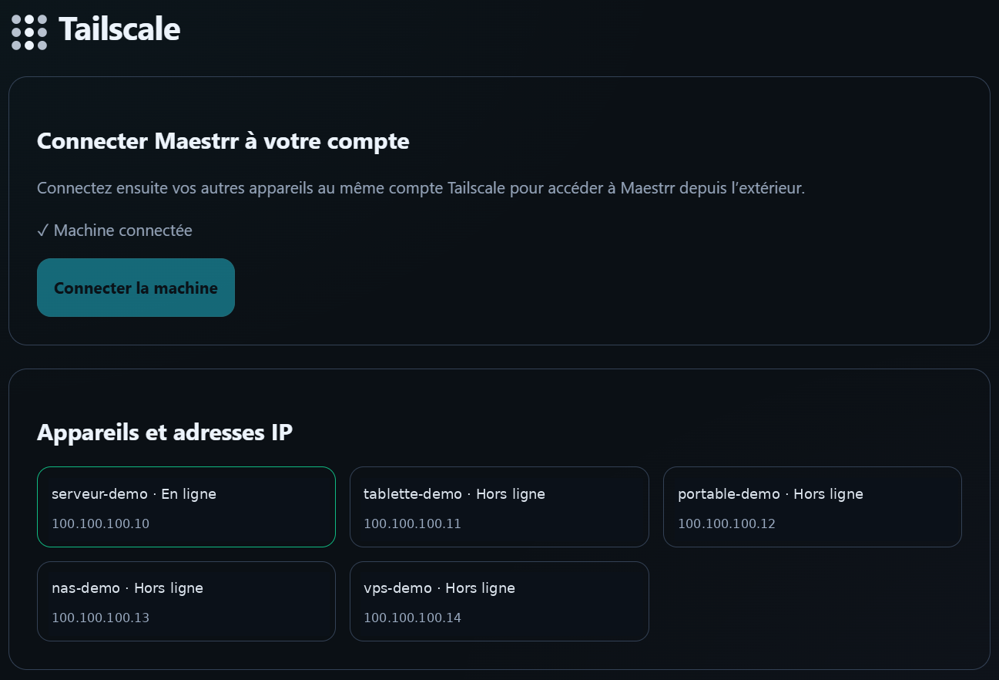
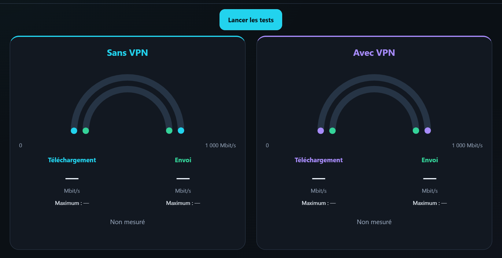

<h1 align="center">Maestrr — Votre multimédia, chez vous</h1>

Installez votre serveur. Découvrez vos médias. Pilotez vos applications.

<strong>Auto-hébergé · Windows · Linux · TrueNAS SCALE 24.10+ · Mobile et tablette</strong>

## Télécharger Maestrr

| Canal | Installateur Windows x64 |
| --- | --- |
| **Bêta publique · 1.6.0-beta.11** | **[⬇ Télécharger Maestrr Setup (.exe)](https://github.com/Maestrr-app/maestrr-releases/releases/download/v1.6.0-beta.11/Maestrr-Setup-1.6.0-beta.11-win-x64.exe)** |
| **Stable** | Pas encore publiée — [consulter les versions](https://github.com/Maestrr-app/maestrr-releases/releases) |

[Notes de version](https://github.com/Maestrr-app/maestrr-releases/releases/tag/v1.6.0-beta.11) · [Empreinte SHA256 du setup](https://github.com/Maestrr-app/maestrr-releases/releases/download/v1.6.0-beta.11/Maestrr-Setup-1.6.0-beta.11-win-x64.exe.sha256) · [Toutes les versions](https://github.com/Maestrr-app/maestrr-releases/releases)

Le setup se lance sur **Windows** : il installe sur ce PC ou prépare votre serveur **Linux / TrueNAS par SSH**. Il n'existe pas d'EXE distinct pour Linux ou TrueNAS.

> **Version bêta :** testez d'abord sur une installation non critique et sauvegardez vos configurations. L'installateur actuel n'est pas signé : Windows peut afficher un avertissement SmartScreen. Téléchargez uniquement depuis les publications officielles et vérifiez l'empreinte.

## Votre serveur, une seule interface

Films, séries, animés et albums : recherchez, découvrez, demandez et retrouvez les médias de votre collection. Maestrr rassemble le suivi des services que vous configurez ; Jellyfin assure la lecture.

### Découvrir films, séries, animés et musique

Explorez les bannières de découverte et les catalogues par catégorie, studio ou genre. Les fiches regroupent les métadonnées disponibles et les actions de votre installation.

### Demander un média et suivre sa disponibilité

Choisissez la qualité et le dossier de destination. Retrouvez le statut, les fichiers disponibles et le bouton de lecture lorsque le média est reconnu dans Jellyfin.

### Choisir les saisons et les épisodes

Les séries et séries animées disposent d'une sélection par saison, avec accès aux épisodes.

### Suivre les téléchargements

Consultez la progression, les débits et les contrôles individuels ou groupés depuis le dashboard, selon vos droits.

### Piloter les applications

Accédez aux applications et à leurs commandes, aux notifications, aux comptes, aux journaux et aux mises à jour.

| Application | Rôle |
| --- | --- |
| Jellyfin | Médiathèque et lecture |
| Radarr / Sonarr / Lidarr | Films, séries et albums |
| Prowlarr / qBittorrent / Bazarr | Indexeurs, téléchargements et sous-titres |
| Listenarr | Livres audio, avec configuration propre à l'application |
| Immich | Gestion de vos photos et vidéos |
| Nginx Proxy Manager | Gestion de proxy inverse |
| Tailscale | Accès distant privé |
| Gluetun | VPN optionnel pour les téléchargements |
| Dockge | Gestion des stacks sur les parcours compatibles ; TrueNAS utilise ses Apps natives |

Vous choisissez les applications à installer. Les logiciels tiers conservent leurs propres prérequis et conditions.

### Accéder à votre serveur à distance

Connectez vos appareils au même réseau Tailscale et configurez vos liens HTTPS. Le dashboard s'utilise dans un navigateur sur ordinateur, iPad ou téléphone et peut être ajouté à l'écran d'accueil.

### Comparer la connexion avec et sans VPN

Lancez le test de débit intégré pour observer votre connexion. La capture ci-dessous montre l'interface avant mesure, sans résultat de performance annoncé.

## Installation

1. Téléchargez le **setup Windows** en haut de cette page.
2. Choisissez Windows local, Linux par SSH ou TrueNAS SCALE 24.10 et versions suivantes compatibles.
3. Vérifiez les prérequis, les dossiers et les permissions avec le diagnostic du setup.
4. Sélectionnez vos applications, leurs ports et vos comptes.
5. Configurez les services souhaités, puis lancez l'installation.

Sur TrueNAS, prévoyez un pool Apps et des datasets de données accessibles aux applications. La compatibilité exacte dépend de la version du NAS ; les versions candidates demandent une validation particulière.

Les guides d'installation et d'utilisation sont accessibles depuis le setup et votre installation. Maestrr ne fournit aucun média, abonnement ou accès aux catalogues privés : vous configurez vos propres services et sources autorisées.

## Mises à jour et données

Les publications officielles sont distribuées dans les [Releases](https://github.com/Maestrr-app/maestrr-releases/releases). Le gestionnaire intégré distingue Maestrr et les applications Docker sur les installations compatibles. Une modification du code privé ne distribue pas automatiquement une mise à jour.

Chaque instance garde ses comptes, configurations et volumes. Les recherches et les images contactent les fournisseurs intégrés, notamment TMDB, MusicBrainz, ListenBrainz, Apple et Fanart.tv. Sauvegardez vos données avant les mises à jour.

<strong>Paquet dashboard pour les installations existantes</strong>

Le [paquet dashboard 1.6.0-beta.11](https://github.com/Maestrr-app/maestrr-releases/releases/download/v1.6.0-beta.11/maestrr-dashboard-v2.tar.gz) est destiné au mécanisme de mise à jour des installations compatibles. Pour une première installation, utilisez le setup EXE.

**Suivre les versions :** Watch → Custom → Releases sur ce dépôt.

*Captures fournies pour présenter l'interface ; son apparence et les options peuvent évoluer. Les affiches, noms et logos tiers appartiennent à leurs détenteurs respectifs et n'impliquent aucun partenariat. Les sources de développement restent privées.*
