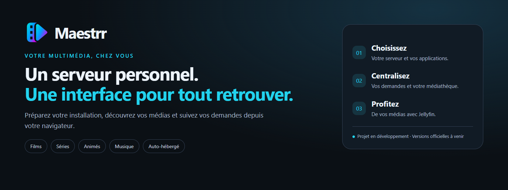
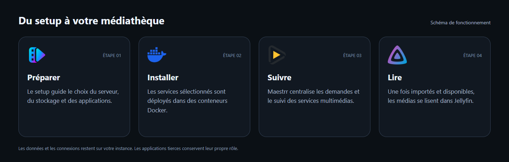
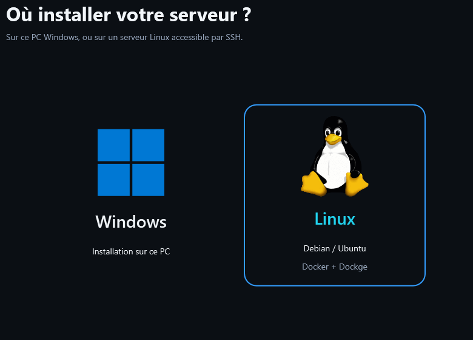

  

<h1 align="center">Maestrr — Votre multimédia, chez vous</h1>

  Un assistant d’installation et un dashboard pour retrouver vos médias, 
  centraliser vos demandes et suivre votre serveur depuis votre navigateur.

  <strong>Auto-hébergé</strong> · <strong>Windows & Linux</strong> · <strong>Interface web mobile et tablette</strong>

  <a href="#téléchargements">Téléchargements</a> ·
  <a href="#comment-ça-fonctionne">Fonctionnement</a> ·
  <a href="#les-applications-et-leur-rôle">Applications</a> ·
  <a href="#préparer-son-installation">Installation</a> ·
  <a href="#questions-fréquentes">Questions fréquentes</a>

> **Projet en développement.** Aucune version officielle n’est encore disponible au téléchargement. Cette page présente le projet ; les distributions seront publiées après validation. Les visuels sont indicatifs et l’interface continue d’évoluer.

## Téléchargements

Les versions validées seront disponibles dans les **[Releases officielles](https://github.com/Maestrr-app/maestrr-releases/releases)** de ce dépôt.

| Distribution | Usage | Disponibilité |
| --- | --- | --- |
| Setup Windows | Préparer une installation sur le PC ou sur un serveur Linux par SSH | À venir |
| Mise à jour du dashboard | Actualiser une instance compatible en conservant sa configuration | À venir |
| Application Android native | Projet distinct, pour une étape ultérieure | Pas encore disponible |

Chaque publication précisera la version, les nouveautés, les prérequis, les instructions et les fichiers de contrôle **SHA-256**. Les versions beta seront distinguées des versions stables. Aucun exécutable de développement n’est proposé ici.

## Pourquoi Maestrr ?

Un serveur multimédia réunit plusieurs applications, chacune avec son rôle et ses réglages. Maestrr les rassemble dans un parcours commun, de la préparation du serveur à l’ouverture d’un média disponible.

- **Installer avec un guide** : destination, vérification de la machine, stockage, applications, comptes, catalogue et accès aux services.
- **Découvrir vos médias** : films, séries, animation et albums, avec fiches et informations issues des catalogues intégrés.
- **Suivre les demandes** : recherche, téléchargement, importation et disponibilité dans la médiathèque.
- **Retrouver votre collection** : librairie, éléments suivis, filtres et recherche.
- **Piloter votre instance** : applications, notifications, informations réseau, journaux et gestion des mises à jour.
- **Utiliser plusieurs écrans** : navigateur sur ordinateur, mobile ou tablette ; ajout à l’écran d’accueil lorsque le navigateur le permet.

Maestrr ne fournit pas de films, d’albums ou d’abonnements : il organise votre installation et les services que vous avez configurés.

## Comment ça fonctionne

### 1. Préparer le serveur

Le setup s’exécute sur Windows. Il permet de choisir une installation sur ce PC ou sur un serveur Linux accessible par SSH, puis de préparer les dossiers et les applications souhaitées.

  

<em>Aperçu de l’étape de choix de destination. L’apparence peut évoluer entre les versions.</em>

### 2. Choisir les applications

Sélectionnez les composants utiles à votre serveur. Le setup prépare leur déploiement et leurs connexions prises en charge, avec les ports et les accès de votre instance.

### 3. Découvrir et suivre

Depuis le dashboard, recherchez un média, ouvrez sa fiche et envoyez une demande. Maestrr affiche ensuite les informations disponibles auprès des services : recherche en cours, suivi, téléchargement, importation ou disponibilité.

### 4. Lire dans Jellyfin

Lorsqu’un média est importé et reconnu dans Jellyfin, le dashboard propose un accès à sa lecture. Jellyfin reste le serveur de lecture ; Maestrr en facilite l’accès et le suivi.

## Les applications et leur rôle

| Composant | Rôle dans l’installation |
| --- | --- |
| **Maestrr Dashboard** | Recherche, demandes, fiches, librairie, suivi et interface du serveur |
| **Docker / Compose** | Déploiement et fonctionnement des services dans leurs conteneurs |
| **Jellyfin** | Médiathèque et lecture des médias disponibles |
| **Radarr** | Gestion et suivi des films |
| **Sonarr** | Gestion des séries, saisons et épisodes |
| **Lidarr** | Gestion des artistes et des albums |
| **Prowlarr** | Centralisation des indexeurs configurés et connexion aux applications compatibles |
| **qBittorrent** | Gestion des téléchargements pris en charge |
| **Bazarr** | Gestion des sous-titres des films et séries |
| **Listenarr** | Composant optionnel pour les livres audio ; configuration propre à cette application |
| **Dockge** | Interface de gestion des stacks Docker sur Linux |
| **Tailscale** | Accès distant privé lorsque cette option est configurée |
| **Gluetun / VPN** | Connexion VPN des services concernés, si vous activez cette option |

Les métadonnées et illustrations utilisent les sources intégrées selon le média, notamment **TMDB**, **MusicBrainz**, **ListenBrainz**, **Apple** et **Fanart.tv**. Leur disponibilité dépend des catalogues et des accès configurés.

Les applications tierces conservent leurs propres conditions, versions et fonctionnalités. Elles ne sont pas toutes obligatoires.

## Préparer son installation

Avant la première version publique, vous pouvez préparer :

1. **La machine** : un PC Windows pour lancer le setup ; pour une installation distante, un serveur Debian/Ubuntu avec un accès SSH.
2. **Le stockage** : des dossiers dédiés aux configurations et aux médias, avec une capacité suffisante.
3. **Les accès** : les comptes ou clés nécessaires aux services que vous souhaitez connecter, notamment TMDB et les indexeurs choisis.
4. **Les options réseau** : accès local, Tailscale si vous souhaitez un accès distant, et configuration VPN si vous l’utilisez.
5. **Les sauvegardes** : un emplacement et une stratégie adaptés à vos configurations et à votre collection.

Les prérequis matériels, versions de systèmes prises en charge et étapes exactes seront précisés dans chaque publication. Un abonnement VPN n’est pas obligatoire pour utiliser Maestrr.

## Vos données restent sur votre instance

Chaque installation possède ses propres comptes, paramètres, connexions et services. **Aucun compte Maestrr centralisé ni serveur de commande commun n’est nécessaire.**

L’auto-hébergement n’exclut pas les connexions aux services externes que vous activez : les recherches de catalogue, images et vérifications de versions contactent leurs fournisseurs respectifs.

Pour un accès hors de chez vous, Tailscale et les liens HTTPS peuvent être utilisés après configuration. Le dashboard peut alors être ajouté à l’écran d’accueil d’un appareil compatible ; cela ne remplace pas une application Android native.

## Mises à jour

Le gestionnaire intégré au menu **Système → Mises à jour** est en cours de validation pour les installations Linux compatibles.

- Les publications Maestrr seront détectées depuis ce dépôt public, après publication d’un paquet officiel compatible.
- Les applications Docker autorisées peuvent être vérifiées et mises à jour indépendamment.
- Les modes manuel, détection avec notification et automatique par application sont prévus dans le module.
- Les mises à jour automatiques demandent une activation explicite ; elles ne sont pas imposées aux services tiers.
- Les comptes, configurations et volumes existants sont conservés par le mécanisme prévu. Une sauvegarde et une validation de compatibilité restent nécessaires ; un retour d’image n’annule pas une migration de base de données.

Un simple push du code privé n’est **pas** une mise à jour distribuée. Il faut un artefact validé et une publication officielle.

## Questions fréquentes

<strong>Est-ce un service hébergé par Maestrr ?</strong>

Non. Vous hébergez votre instance et vos services sur votre propre machine. Ce dépôt distribue les versions officielles lorsqu’elles sont prêtes.

<strong>Faut-il déjà connaître toutes les applications ?</strong>

Le setup explique les étapes et le rôle des composants. Les applications conservent toutefois leurs propres réglages et prérequis ; certaines options demandent une configuration complémentaire.

<strong>Peut-on utiliser Maestrr sur iPad ou Android ?</strong>

Le dashboard est accessible dans un navigateur compatible et son interface s’adapte aux écrans mobiles et tablettes. Après configuration de l’accès, il peut être ajouté à l’écran d’accueil. L’application Android native est un projet ultérieur.

<strong>Où seront les téléchargements ?</strong>

Dans l’onglet [Releases](https://github.com/Maestrr-app/maestrr-releases/releases) de ce dépôt. Pour le moment, aucune distribution officielle n’y est publiée.

<strong>Pourquoi les dépôts de développement ne sont-ils pas visibles ?</strong>

Cette page est consacrée à la présentation et aux distributions publiques. Les dépôts de développement sont séparés et privés.

---

**Suivre les prochaines versions :** utilisez **Watch → Custom → Releases** sur ce dépôt pour recevoir les annonces GitHub.

*Les noms et logos des applications tierces appartiennent à leurs détenteurs respectifs. Leur présence explique les intégrations et n’implique aucun partenariat. Les logos tiers utilisés dans le schéma proviennent de [Homarr Dashboard Icons](https://github.com/homarr-labs/dashboard-icons). Les visuels de présentation ne représentent pas une version publique déjà distribuée.*
